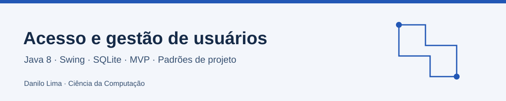

# Acesso e gestão de usuários

Aplicação desktop Java para estudar gestão de usuários, notificações e organização de camadas. A árvore de código reúne padrões como Command, State, Observer e Adapter.

**Estudo de arquitetura e padrões · acervo de computação**

Java 8 · Swing · SQLite · MVP · Padrões de projeto

[English](README.en.md) · [Meu percurso em Ciência da Computação](https://github.com/Danilo-Js/My-Computer-Science-Course)

## O que este projeto explora

- Separação de responsabilidades entre view, presenter, service, repository e DAO.
- Comandos e estados para organizar ações e modos de edição.
- Adaptação de formatos de log e propagação de notificações.

## Como explorar

| Caminho | Conteúdo |
|---|---|
| [Código organizado por camadas](acesso_usuarios/src/main/java/ufes/acesso_usuarios) | `acesso_usuarios/src/main/java/ufes/acesso_usuarios` |
| [Configuração Maven](acesso_usuarios/pom.xml) | `acesso_usuarios/pom.xml` |
| [Entrada](acesso_usuarios/src/main/java/ufes/acesso_usuarios/Acesso_usuarios.java) | `acesso_usuarios/src/main/java/ufes/acesso_usuarios/Acesso_usuarios.java` |

## Executar ou consultar

Importe o Maven a partir da subpasta `acesso_usuarios/`. Execute a classe `ufes.acesso_usuarios.Acesso_usuarios` na IDE, com o diretório de trabalho ajustado aos caminhos de banco do projeto. O pom declara Java 8 e sqlite-jdbc. Use um banco de estudo; credenciais e dados existentes não são publicados nesta documentação.

## Conceitos e contexto

Exercício desktop. A presença de uma tela de login não comprova um sistema de autenticação pronto para produção.

## Autoria e procedência

Acervo mantido por Danilo Lima. Cabeçalhos e créditos originais do código permanecem como referência de procedência. Não se atribui disciplina ou autoria exclusiva que os documentos não estabelecem.

## Licença

Os termos deste acervo estão em [LICENSE](LICENSE). Os projetos e materiais vinculados conservam suas próprias condições e atribuições.

## Projetos relacionados

- [Mediator_Chat](https://github.com/Danilo-Js/Mediator_Chat)
- [EstacaoClimatica](https://github.com/Danilo-Js/EstacaoClimatica)
